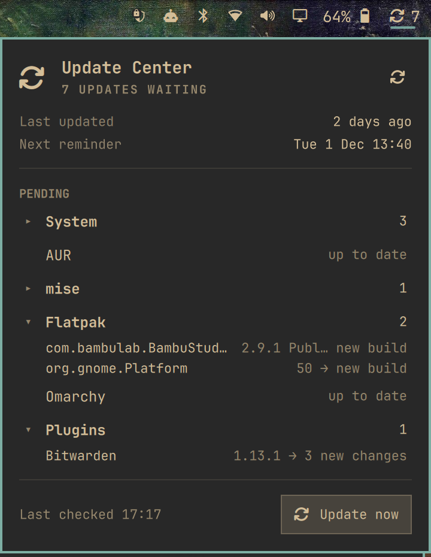

# Update Center

An [Omarchy](https://omarchy.org) bar widget that keeps track of **how long it's been since you last updated** and reminds you once you're overdue. It shows every pending update in one place: system packages, AUR, mise tools, Flatpak apps, shell plugins, and Omarchy itself.

Most update indicators alert you whenever something new appears. Update Center stays quiet until your last full upgrade is older than a week (adjustable) *and* updates are actually waiting, then reminds you once a day until you update. Updating still goes through `omarchy-update`.



## What it shows

- **Bar icon:** always visible. Dim when you're up to date, full brightness with a count when updates are waiting, and in the theme's urgent colour once you're overdue. The count and the urgent colour can each be turned off.
- **Panel** (left-click):
  - your status, and when you last ran a full system upgrade
  - when the next reminder is due
  - pending updates per source, which you can expand to see each package's old → new version. Plugins show the name from their manifest (hover it for the plugin's id). Click a plugin's name to open its new commits on GitHub (or its repo page on other hosts), or an AUR package's name to open its AUR page
  - when it last checked, and an **Update now** button that opens the same floating `omarchy-update` terminal as the Omarchy menu
- **Right-click:** check now.
- **Reminder:** a notification once your last full upgrade is older than 7 days *and* updates are waiting. It repeats daily until you update, and clicking it starts the update. Nothing is waiting? No reminder. Shell plugins show in the panel and the count, but never trigger a reminder on their own.

## Requirements

- **Omarchy** with the Quickshell shell (Omarchy 4 / Quattro). The plugin uses `omarchy-update`, `omarchy-notification-send` and `omarchy-launch-floating-terminal-with-presentation`.
- **`pacman-contrib`** for `checkupdates`, which checks system packages. Omarchy installs it by default.
- **`jq`** and **`util-linux`** (`flock`), both installed on Omarchy by default.
- Optional: **`yay`** to check AUR packages, **`mise`** to check mise tools, **`flatpak`** to check Flatpak apps, and **`git`** to check shell plugins. If any of them is missing, its group is hidden.

It needs no root, installs no hooks or services, and never changes your configuration. It writes two things: `~/.local/state/liambeck99.update-center/state.json`, which records when you were last reminded, and `~/.cache/liambeck99.update-center/checkup-db`, a private copy of the package lists (about 9 MB) for checking system updates.

## Install

```bash
omarchy plugin add https://github.com/liambeck99/omarchy-update-center.git --enable
```

New plugins are added to the right of the bar. Omarchy's own update icon does the same job for Omarchy releases only, so you'll probably want to remove it:

```bash
omarchy plugin disable omarchy.system-update
```

To get it back, run `omarchy plugin enable omarchy.system-update`.

## Update

```bash
omarchy plugin update liambeck99.update-center
omarchy-restart-shell
```

The shell keeps running the old version of the widget until it restarts, so restart it (or log out and back in) after updating.

## Uninstall

```bash
omarchy plugin remove liambeck99.update-center
rm -rf ~/.local/state/liambeck99.update-center   # optional: forget when you were last reminded
rm -rf ~/.cache/liambeck99.update-center         # optional: its copy of the package lists (about 9 MB)
omarchy plugin enable omarchy.system-update      # optional: bring back Omarchy's own update icon
```

## Settings

Omarchy has no settings screen for plugins. Set options with `omarchy bar set`, using `--json` so numbers and true/false aren't saved as text:

```bash
omarchy bar set liambeck99.update-center reminderDays 5 --json
omarchy bar set liambeck99.update-center highlightOverdue false --json
```

They're stored on the widget's entry in `~/.config/omarchy/shell.json`, which you can also edit by hand, e.g. `{"id": "liambeck99.update-center", "reminderDays": 5}`.

| Setting | Default | Meaning |
|---|---|---|
| `reminderDays` | 7 | Remind once the last full upgrade is this many days old |
| `checkIntervalHours` | 6 | How often to check for pending updates in the background |
| `reminderRepeatHours` | 24 | While overdue, how long between reminders |
| `checkSystem` | true | Check official repository packages (`checkupdates`) |
| `checkAur` | true | Check AUR packages (`yay -Qua`) |
| `checkMise` | true | Check mise tools (`mise outdated`) |
| `checkFlatpak` | true | Check Flatpak apps and runtimes (`flatpak remote-ls --updates`) |
| `checkOmarchy` | true | Show a new Omarchy release as its own line |
| `checkPlugins` | true | Check shell plugins installed from git (`omarchy plugin add`) |
| `showCount` | true | Show the number of waiting updates next to the bar icon (off keeps the icon a fixed width) |
| `highlightOverdue` | true | Colour the bar icon with the theme's urgent colour when overdue (off keeps the bar's normal colour; the panel still says you're overdue) |

## How it works

Everything is read-only and needs no root:

- **System:** `checkupdates`, which syncs into a separate copy of the package database and never touches your real one. Update Center keeps its own copy in `~/.cache/liambeck99.update-center/checkup-db` instead of sharing `checkupdates`' default one in `/tmp`: Omarchy's own update check uses that one, and when both check at once, one fails with "Cannot fetch updates".
- **AUR:** `yay -Qua`.
- **mise:** `mise outdated`, with the same release-age override `omarchy-update` uses, so counts match what an update would install. Lazy tools that were never installed aren't counted, because `mise up` skips them; they download the first time you run them.
- **Flatpak:** `flatpak remote-ls --updates`, across system and user installations. Runtimes rebuilt without a version change show as "new build". `omarchy-update` doesn't update Flatpak apps, so **Update now** runs `flatpak update` itself.
- **Plugins:** `git fetch origin HEAD` in each git-managed plugin, as `omarchy plugin update` does. Fetching only updates the plugin's git metadata, not its files. Only what **Update now** can clear is counted. `omarchy plugin update` only fast-forwards, from `origin`, so Update Center does a dry run of that same fast-forward (it changes nothing), and a plugin it can't update is listed with a note but isn't counted as waiting, in the badge or in the Plugins row:
  - "has commits not on upstream": your own commits, or upstream rewrote its history
  - "has local edits": uncommitted edits to files the update changes
  - "local files in the way": untracked files with the same name as files the update adds
  - "no origin remote": checked against its other remote instead

  Edits to files the update doesn't touch, and untracked files such as a `__pycache__` folder, don't get in the way: the update keeps them, so the plugin counts. A plugin with no remote at all, such as one you're writing locally, isn't checked. If some plugins can't be reached, the others still show fresh results, with the unreachable ones named in the error.
- **Last updated:** the most recent `starting full system upgrade` line in `/var/log/pacman.log`. It counts upgrades from `omarchy-update` and from a hand-run `pacman -Syu`.
- **Update running:** when the widget loads and once a minute after that it checks Omarchy's update lock and pacman's `db.lck`, and checks again when an update finishes.

Checks run 45 seconds after login, every `checkIntervalHours`, when you open the panel (at most every two minutes), and after updates. The time of the last reminder is kept in `~/.local/state/liambeck99.update-center/state.json`, so restarting the shell doesn't repeat a reminder.

**Update now** and the reminder run `bin/update-all`, which only updates the kinds of update that are waiting. It holds Omarchy's update lock for the whole run, runs `omarchy-plugin-update` first (it shows each plugin's changes and asks before applying them), then `flatpak update` (it lists the changes and asks too), then `omarchy-update`. When only plugins or Flatpak apps are waiting, it doesn't start a system upgrade.

A source that fails to check (for example, while you're offline) shows its error and keeps its previous results. Those results never trigger a reminder, since they may already be installed, but the failure doesn't hold back a reminder for updates the other sources just found: a plugin whose repo is gone, or a broken Flatpak remote, won't silence reminders for system updates.

From a script:

```bash
omarchy-shell liambeck99.update-center refresh   # check now
omarchy-shell liambeck99.update-center toggle    # open/close the panel
```

## Development

Tests need [Bun](https://bun.sh) (development only, not needed to use the plugin).

```bash
bun test                       # logic and status-script tests (stubbed tools, no network)
bin/update-center-status | jq  # what the panel sees
```

CI runs the tests, [ShellCheck](https://www.shellcheck.net) on `bin/` and `tests/stubs/`, and `omarchy-plugin-validate` on every pull request. Changes reach `main` only through a pull request with a passing check.

Saving files under `~/.config/omarchy/plugins/` hot-reloads the plugin, but the shell can keep the previously compiled QML and `Model.js`. If a change doesn't show up, run `omarchy-restart-shell`.

## License

MIT
